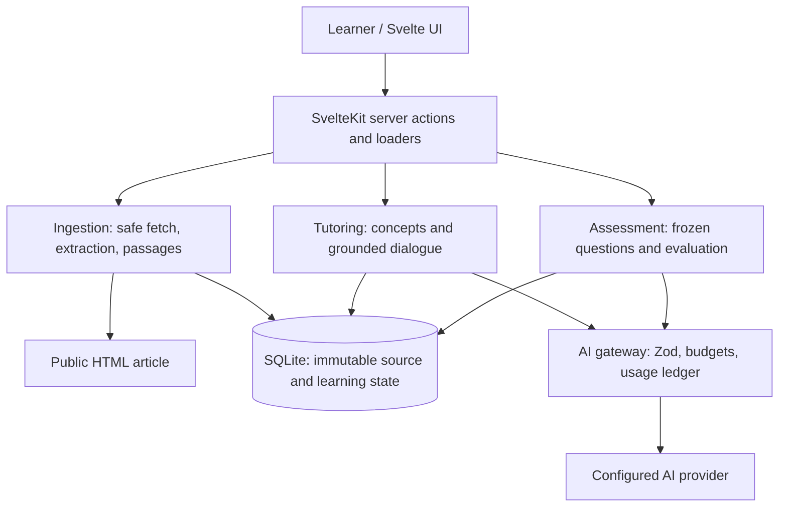

# Architecture proposal and decisions

## Shape

A modular SvelteKit application: Svelte 5 + TypeScript UI, Tailwind CSS, server-side services, SQLite, Zod contracts, and Vitest. Use a Node deployment target with persistent local disk. No separate API server, queue service, agent framework, or vector database.

Only ingestion can fetch article URLs. Only the AI gateway can call the AI provider. All credentials, database access, rubrics, provider requests, and raw provider errors stay server-side.

## Boundaries and contracts

Proposed modules under `src/lib/server/`: `ingestion/`, `tutoring/`, `assessment/`, `ai/`, and `db/`. Shared browser-safe types live outside server modules and must omit secrets and hidden assessment data. SvelteKit actions perform mutations; server loaders return explicit public view models. No generic endpoint that returns entire database rows.

- Ingestion: `ingest(url) → SourceSnapshot`. Deterministic fetching and HTML extraction; no AI required. A small maintained article extractor and DOM parser are justified dependencies, subject to fixture tests. Preserve headings, paragraphs, and code; discard navigation and scripts. Derive numbered passages deterministically from normalized extracted text.
- Tutoring: `identifyConcepts(snapshot) → Concept[]`; `respond(snapshot, concepts, history, question) → GroundedReply`. No evaluation or source mutation.
- Assessment: `generateAssessment(snapshot, concepts) → FiveQuestionsWithRubrics`; `evaluate(snapshot, frozenAssessment, answers) → Evaluation`. Grade without tutor history to reduce bias; retain the assisted-practice flag separately.
- AI gateway: provider adapter accepts task/version, structured input, Zod output schema, token limits, and budget context. Returns validated data and usage metadata. Validate passage references and cross-field constraints after schema parsing. A valid JSON shape alone does not prove factual grounding.
- Database layer: parameterized SQL, small versioned migrations, transactions for multi-row state transitions. No network call inside a database transaction.

All AI responses have strict schemas: concept identifiers and passage references; tutor answer plus evidence and insufficient-evidence flag; five question objects with concept IDs, type, rubric criteria and evidence; and five evaluation items with criterion results, score, gaps, evidence, and revisit actions. Schema arrays and IDs are validated against the actual session. Reject extra fields and unsupported references. Store prompt/schema/model versions for reproducibility.

## Source grounding and assessment

Store the original requested URL, final URL, extraction timestamp, content hash, and immutable normalized content. Passage IDs and offsets address that snapshot, not the live web page. Re-ingestion creates a new session and snapshot. Citations navigate to the locally stored passage and link out to the original article.

Pass the full snapshot to the model for MVP articles within a configured context budget, reserving room for instructions, history, and output. Proposed ceiling: 12,000 source tokens, with a conservative estimate if the selected provider has no tokenizer. Reject oversized articles with an explanation; never silently truncate. Bound dialogue history and clearly indicate when older turns are omitted; always retain source evidence. Retrieval can be evaluated later if real articles exceed these limits.

Each question has two frozen criteria scored 0 (missing/incorrect), 1 (partial), or 2 (correct with sound reasoning). Derive question scores (0–4) and total (0–20) in application code. The evaluator returns criterion judgments, evidence, and feedback; it cannot choose a different scoring scale. Accept equivalent reasoning rather than exact wording. Flag ambiguous grading for review and do not include it in a definitive total until resolved. Report uncertainty and source limitations. A source may itself be wrong: assess understanding of its claims, distinguish this from externally verified truth, and allow justified critique.

Question generation must pass evidence and concept-coverage checks before it is shown. A short or thin article that cannot support five meaningful questions fails explicitly. Keep rubrics and expected reasoning hidden until submission. Dashboard concept status is derived from criterion results linked to concepts: demonstrated if all mapped criteria are fully met, revisit if any are not, and unassessed if none map to it. These labels describe this attempt only.

## Untrusted content and local security

Accept HTTP(S) URLs only, without embedded credentials, on standard ports. Reject localhost, private, link-local, multicast, reserved and metadata destinations, including IPv6 and mapped IPv4. Resolve and validate every address; pin the validated destination in the actual connection while preserving TLS hostname checks. Revalidate every redirect, maximum three. A preflight DNS lookup followed by an unrestricted fetch is insufficient because of DNS rebinding. Use no ambient cookies or authorization headers.

Proposed fetch limits: 15 seconds overall, 2 MiB decompressed HTML, HTML content types only. Stop oversized streams; reject unsupported encodings/content instead of attempting arbitrary downloads. Render extracted text and fenced code safely; never render source HTML or unescaped model HTML. Browser security headers and server-side input validation apply to all actions.

Treat source passages, learner messages, and answers as data, not instructions. Fixed task instructions explicitly prohibit following embedded commands. The model has no tools, filesystem access, credentials, or unrestricted fetch capability. Prompt separation helps but is not a complete defense; test injection resistance and constrain effects through capabilities, schemas, and citation checks.

Bind to loopback by default. Validate mutation request origins and retain SvelteKit's CSRF protection; no wildcard CORS. Remote access requires a separate authentication and deployment design. Send article content and learner responses only to the configured AI provider, with visible disclosure before the first call. Avoid logging full answers or source content; never log credentials. Local database retention is indefinite until explicitly deleted; session deletion cascades learning records and usage records, while spend guards retain any necessary aggregate reservation in memory until outstanding calls settle. Back up the database using a consistent SQLite backup operation; it contains personal learning data.

## Execution, failure, and cost

Run bounded operations in request/response handlers for the MVP. Persist a pending operation before contacting the provider; only validated results advance domain state. Use an idempotency key and one active mutation per session. A double submission must not create two evaluations or two deliberate provider calls. On restart, mark unfinished operations interrupted/usage unknown and let the learner explicitly retry. Never claim exactly-once provider billing after a network timeout.

Gateway defaults proposed for review: one concurrent paid operation per session, 60-second provider deadline, output token ceilings per task, USD 0.50 session cap, and configurable local daily cap of USD 2.00. Before dispatch, atomically reserve a conservative upper-bound cost from configured token ceilings and a dated pricing snapshot. Include active reservations in budget checks. Settle using provider-reported usage; a timeout retains the reservation as unknown until reconciled or explicitly acknowledged. Missing pricing blocks paid calls. Retries require a new reservation and explicit user action, with at most one schema-repair retry per operation. Show estimated versus reported tokens, estimated spend, model, pricing date, and failed/interrupted attempts. Costs are estimates, not invoice reconciliation.

## Decisions and trade-offs

| Decision | Benefit | Cost / reconsider when |
| --- | --- | --- |
| One local SvelteKit process | Small operational footprint; server-side secrets | Needs durable disk; remote use needs authentication |
| SQLite and direct SQL | Inspectable persistence and few dependencies | Single-writer constraints; move only when measured concurrency requires it |
| Immutable source + passage citations | Reproducible study and review | Stores article text locally; requires snapshot retention |
| Full-source prompts | Straightforward grounding and debugging | Context and token cost limits; retrieval deferred |
| Separate tutor and evaluator services | Different prompts, inputs, and tests; future experiments | Same provider can share biases; human calibration remains necessary |
| One provider adapter initially | Avoids framework and multi-provider complexity | Select model through measured quality/cost; abstraction is a small interface |
| Request-based operations | No worker infrastructure | Bounded latency; durable workers needed if workloads outgrow request limits |
| Formative rubric grading | Transparent, actionable feedback | Cannot establish long-term mastery from five answers |
| No agents or code execution | Predictable privileges and spend | Later experiments need explicit capabilities and budgets |

Future agents should call these typed services through explicit, constrained capabilities. Do not add a general tool executor in the MVP.

## References

- [SvelteKit server-only imports](https://svelte.dev/e/kit/server_only_import): keep secret-bearing modules out of browser import chains.
- [OWASP SSRF prevention](https://cheatsheetseries.owasp.org/cheatsheets/Server_Side_Request_Forgery_Prevention_Cheat_Sheet.html): destination validation and redirect handling inform the fetch boundary.
- [OWASP prompt injection prevention](https://cheatsheetseries.owasp.org/cheatsheets/LLM_Prompt_Injection_Prevention_Cheat_Sheet.html): layered controls and adversarial testing inform the model boundary.
