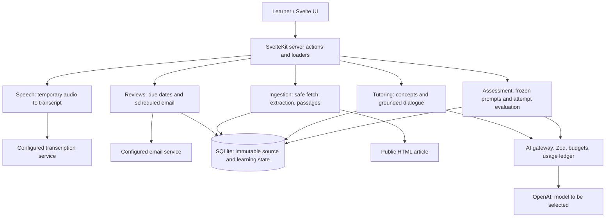

# Architecture proposal and decisions

Status: revised proposal following the requirements interview; no final ADRs or implementation approval are implied. This revision replaces the article-only tutor, fixed five-question assessment, and deferral of scheduled review.

OpenAI is selected as the learning AI provider. The exact model will be selected through bounded evaluation; this choice does not select a transcription provider, authorize paid requests, or approve the rest of this architecture.

## Shape

A modular SvelteKit application: Svelte 5 + TypeScript UI, Tailwind CSS, server-side services, SQLite, Zod contracts, and Vitest. Use a Node deployment target with persistent local disk. No separate API server, queue service, agent framework, or vector database.

Only ingestion can fetch article URLs. Only the AI gateway can call the learning AI provider; speech and reminder adapters have separate, fixed provider boundaries. Models cannot invoke these adapters. All credentials, database access, rubrics, provider requests, and raw provider errors stay server-side.

## Boundaries and contracts

Proposed modules under `src/lib/server/`: `ingestion/`, `tutoring/`, `assessment/`, `speech/`, `reviews/`, `ai/`, and `db/`. Shared browser-safe types live outside server modules and must omit secrets and hidden assessment data. SvelteKit actions perform mutations; server loaders return explicit public view models. No generic endpoint that returns entire database rows.

- Ingestion: `ingest(url) → SourceSnapshot`. Deterministic fetching and HTML extraction; no AI required. A small maintained article extractor and DOM parser are justified dependencies, subject to fixture tests. Preserve headings, paragraphs, and code; discard navigation and scripts. Derive numbered passages deterministically from normalized extracted text.
- Tutoring: `identifyConcepts(snapshot) → Concept[]`; `respond(snapshot, concept, boundedContext, question) → TutorReply`. Establish prior knowledge, choose prerequisite support, and ask one targeted probe before correction unless direct help is requested. Context includes relevant prior attempts and assistance with provenance, not an assumed permanent learner level. Keep article-backed claims, illustrative examples, and supplementary prerequisites distinct. No evaluation or source mutation.
- Assessment: `generatePrompt(snapshot, concept, audience, attemptKind, priorTask) → PromptWithCriteria`; `evaluate(snapshot, frozenPrompt, submittedResponse) → Evaluation`. One focused prompt per attempt; initial, probe, changed-example, later-review, and optional writing attempts can repeat. Evaluate without persuasive tutor commentary; store factual assistance events separately and use them to qualify the public evidence label. A help request freezes that attempt's unaided boundary; a new prompt is needed for a later unaided claim.
- Speech: bounded audio upload → transcription → learner-corrected draft. Validate recording size/type/duration, disclose provider transmission, and clean up temporary audio on success, failure, cancellation, or restart. Do not put audio in SQLite or logs. Text remains a fallback. Provider and supported formats/limits remain to be selected.
- Reviews: derive a proposed next date from accepted reasoning evidence and assistance using a versioned simple rule, allow override, and persist due state. An explicit adapter schedules/cancels one upcoming concept reminder with an external email service; the provider delivers while the local app is closed. Do not add a continuously running local worker or assume the laptop is online at delivery time. Scheduling rules, provider scheduling horizon, and cancellation/reconciliation capabilities remain to be validated before implementation. If a due date exceeds that horizon, preserve the due date and visibly report that email is not yet scheduled; do not imply offline delivery is arranged.
- AI gateway: provider adapter accepts task/version, structured input, Zod output schema, token limits, and budget context. Returns validated data and usage metadata. Validate passage references and cross-field constraints after schema parsing. A valid JSON shape alone does not prove factual grounding.
- Database layer: parameterized SQL, small versioned migrations, transactions for multi-row state transitions. No network call inside a database transaction.

All AI responses have strict schemas: concept IDs and evidence; tutor reply with claim provenance and insufficient-evidence flags; one prompt with concept, audience, task kind, expected reasoning and frozen criteria; evaluation with criterion judgments, reasoning gaps, separate clarity feedback, uncertainty, and revisit actions. Validate IDs, evidence membership, task relationships, and cross-field constraints. Reject extra fields and unsupported references. Store prompt/schema/model versions for reproducibility. There is no mandatory question count, fixed scoring scale, or aggregate score.

## Source grounding and AI-led assessment

Store the original requested URL, final URL, extraction timestamp, content hash, and immutable normalized content. Passage IDs and offsets address that snapshot, not the live web page. Re-ingestion creates a new session and snapshot. Citations navigate to the locally stored passage and link out to the original article.

Pass the full snapshot to the model for MVP articles within a configured context budget, reserving room for instructions, relevant attempts, history, and output. Proposed ceiling: 12,000 source tokens, with a conservative estimate if the selected provider has no tokenizer. Reject oversized articles with an explanation; never silently truncate. Bound dialogue history and clearly indicate when older turns are omitted; always retain source evidence. Retrieval can be evaluated later if real articles exceed these limits.

Supplementary prerequisite explanations may use the model's general knowledge, but are labelled supplementary and not externally verified. They cannot acquire article citations or silently become grading criteria. A fair assessment remains supported by the frozen article and explicit task assumptions; narrow or abstain when evidence is insufficient. A source may itself be wrong: distinguish understanding its claims from verified truth and allow justified critique. No browsing or verification service is added in the MVP.

The AI tutor conducts practice and a separate AI evaluator judges submitted explanations. No human practice buddy is required. Separate prompts and inputs reduce some bias but do not establish evaluator reliability; human calibration belongs to development/release evaluation, not the learner's practice loop.

Freeze each prompt, criteria, expected reasoning, and source references before showing the question. Public criteria describe reasoning dimensions without revealing the answer. Evaluate conceptual accuracy, mechanism, application, and limitations as applicable to the task, using supported/partial/gap/uncertain judgments. Explanation clarity is separate: logical order, explicit links, examples, and audience fit. Grammar, accent, pauses, and vocabulary sophistication do not lower reasoning judgments. Ask for clarification when meaning is unclear. Do not penalise transcription errors: submit the learner-confirmed transcript, retaining the initial transcript only as disclosed local text provenance.

Feedback identifies sound reasoning and a specific gap/action. Preserve an immutable submitted response and evaluation. A challenge appends clarification and a revised judgment linked to the original; never overwrite the history or count new substantive reasoning in a clarification as original unaided performance. Unresolved ambiguity remains uncertain. Separate a service retry from a new learning attempt.

After help, use a fresh application or changed assumption rather than asking for a verbatim correction. Store attempt kind, relationship to the earlier task, assistance, audience, and date. Derive evidence descriptions for helped practice, unaided changed-example reasoning, and later unaided review, keeping gaps and unassessed dimensions visible. No permanent mastered/understood label or aggregate score. An optional learner confidence report is independent of evaluation.

## Review scheduling and email lifecycle

Persist one review plan per concept and append dated attempts. Start with a visible, overrideable rule: sound unaided reasoning lengthens the interval; gaps or substantial help shorten it. Exact intervals, ambiguity behavior, delivery time, and time zone settings remain implementation decisions; do not present the schedule as a proven retention model. A review starts before earlier answers or feedback are revealed and records any subsequent help.

Use a service capable of holding a scheduled message remotely. Store desired due date, plan revision, provider message ID, and explicit pending/scheduled/cancelled/finished/failed/unknown state. A finished reminder is no longer an active schedule; record delivered status only with provider evidence, otherwise retain delivery as unconfirmed. Use idempotency where available and stable request keys; a timeout is unknown, not successful or safe to resend blindly. On early review, date change, opt-out, or deletion, reconcile cancellation before replacement so two known active reminders are not deliberately created. The local request attempts reconciliation; on restart/open, reconcile unfinished changes. Provider-side delivery may race with cancellation or occur while the app is offline, so show unresolved state and do not promise perfect cancellation or exactly-once delivery.

Reminder content is a short concept title and invitation to practise, without answers, scores, or corrections. Practice requires starting the local laptop app; the email is not a remotely accessible practice link. The app shows due/overdue concepts but sends no repeated overdue emails. Scheduling failure preserves the due date and learning results with explicit retry. Retain minimal cancellation metadata until outstanding remote messages are resolved, including on session deletion; purge learning content separately. Do not claim remote cancellation completed when offline.

## Untrusted content and local security

Accept HTTP(S) URLs only, without embedded credentials, on standard ports. Reject localhost, private, link-local, multicast, reserved and metadata destinations, including IPv6 and mapped IPv4. Resolve and validate every address; pin the validated destination in the actual connection while preserving TLS hostname checks. Revalidate every redirect, maximum three. A preflight DNS lookup followed by an unrestricted fetch is insufficient because of DNS rebinding. Use no ambient cookies or authorization headers.

Proposed fetch limits: 15 seconds overall, 2 MiB decompressed HTML, HTML content types only. Stop oversized streams; reject unsupported encodings/content instead of attempting arbitrary downloads. Render extracted text and fenced code safely; never render source HTML or unescaped model HTML. Browser security headers and server-side input validation apply to all actions.

Treat source passages, learner messages, and answers as data, not instructions. Fixed task instructions explicitly prohibit following embedded commands. The model has no tools, filesystem access, credentials, or unrestricted fetch capability. Prompt separation helps but is not a complete defense; test injection resistance and constrain effects through capabilities, schemas, and citation checks.

Bind to loopback by default. Validate mutation request origins and retain SvelteKit's CSRF protection; no wildcard CORS. Remote access requires a separate authentication and deployment design. Disclose each external destination before its first use: article content and responses to the learning AI provider, temporary audio to the transcription provider, and recipient address/minimal reminder content to the email provider. Explain provider retention separately from local cleanup. Keep email, speech, and AI credentials server-side. Avoid logging full answers or source content; never log credentials. Local database retention is indefinite until explicitly deleted; session deletion cancels outstanding reminders or retains minimal cancellation metadata while cascading learning records and usage records. Spend guards retain any necessary aggregate reservation in memory until outstanding calls settle. Back up the database using a consistent SQLite backup operation; it contains personal learning data.

## Execution, failure, and cost

Run bounded operations in request/response handlers for the MVP. Persist a pending operation before contacting the provider; only validated results advance domain state. Use an idempotency key and one active mutation per session. A double submission must not create two evaluations or two deliberate provider calls. On restart, mark unfinished operations interrupted/usage unknown and let the learner explicitly retry. Never claim exactly-once provider billing after a network timeout.

The gateway cost policy covers learning calls and transcription through task-specific pricing units (tokens or audio duration). Email charges have a separate visible ledger/limit; do not apply token arithmetic to them. Provider features without supported price accounting must be blocked or explicitly scoped before implementation.

Gateway defaults proposed for review: one concurrent paid operation per session, 60-second provider deadline, output token ceilings per task, USD 0.50 session cap, and configurable local daily cap of USD 2.00. Before dispatch, atomically reserve a conservative upper-bound cost from configured token or recording-duration ceilings and a dated pricing snapshot. Include active reservations in budget checks. Settle using provider-reported usage; a timeout retains the reservation as unknown until reconciled or explicitly acknowledged. Missing pricing blocks paid calls. Retries require a new reservation and explicit user action, with at most one schema-repair retry per operation. Show estimated versus reported tokens/audio duration, estimated spend, model, pricing date, and failed/interrupted attempts. Costs are estimates, not invoice reconciliation.

## Decisions and trade-offs

| Decision | Benefit | Cost / reconsider when |
| --- | --- | --- |
| One local SvelteKit process | Small operational footprint; server-side secrets | Needs durable disk; remote use needs authentication |
| SQLite and direct SQL | Inspectable persistence and few dependencies | Single-writer constraints; move only when measured concurrency requires it |
| Immutable source + passage citations | Reproducible study and review | Stores article text locally; requires snapshot retention |
| Full-source prompts | Straightforward grounding and debugging | Context and token cost limits; retrieval deferred |
| Separate tutor and evaluator services | Different prompts, inputs, and tests; future experiments | Same provider can share biases; human calibration remains necessary |
| One learning-model adapter initially | Avoids a multi-model framework | Select model through measured quality/cost; speech and email use separate small adapters |
| Request-based operations | No worker infrastructure | Bounded latency; durable workers needed if workloads outgrow request limits |
| AI-led attempt feedback | No human practice buddy; targeted reasoning and clarity feedback | Requires development calibration; later reviews provide limited dated evidence, not certified mastery |
| Turn-based speech and corrected transcripts | Supports verbal explanation without live voice infrastructure | External transcription, temporary audio cleanup, and duration-based costs |
| Scheduled external email | Reminder delivery while local app is closed | Additional provider, cancellation races, recipient settings, and separate cost accounting |
| No agents or code execution | Predictable privileges and spend | Later experiments need explicit capabilities and budgets |

Future agents should call these typed services through explicit, constrained capabilities. Do not add a general tool executor in the MVP.

## References

- [SvelteKit server-only imports](https://svelte.dev/e/kit/server_only_import): keep secret-bearing modules out of browser import chains.
- [OWASP SSRF prevention](https://cheatsheetseries.owasp.org/cheatsheets/Server_Side_Request_Forgery_Prevention_Cheat_Sheet.html): destination validation and redirect handling inform the fetch boundary.
- [OWASP prompt injection prevention](https://cheatsheetseries.owasp.org/cheatsheets/LLM_Prompt_Injection_Prevention_Cheat_Sheet.html): layered controls and adversarial testing inform the model boundary.
